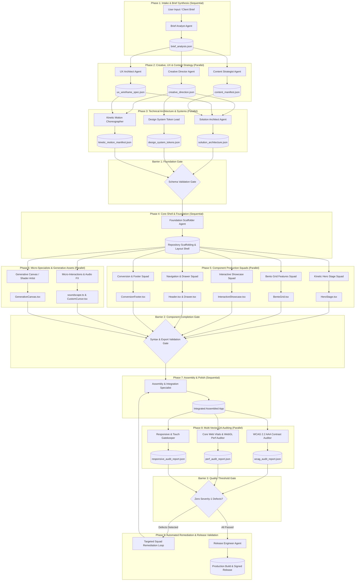

# Enterprise Multi-Agent System (MAS) Architectural Blueprint
## Production-Grade Awwwards-Winning Website Agency Architecture

*Document Version:* 1.0.0  
*Status:* Official Architectural Specification  
*Author:* Lead Systems and Organizational Architect  
*Target Engine:* Multi-Agent Autonomous Agency Platform  
*Workspace Root:* `mas_agency`

---

## Executive Summary & Architectural Tenets

Modern web applications that win international acclaim—such as Awwwards Site of the Month or Developer of the Year—require the synthesis of diverse disciplines: avant-garde art direction, mathematical kinetic choreography, robust systems engineering, rigorous accessibility (WCAG 2.2 AAA), and sub-millisecond rendering performance.

Monolithic LLM prompts or unstructured agent swarms fail catastrophically when attempting end-to-end design and engineering. Common failure modes include:
1. **Context Dilution & Hallucination:** Agents tasked with both visual direction and React DOM implementation produce generic, boilerplate code with broken imports and mismatched color palettes.
2. **Instruction Drift:** As context lengths expand beyond 8,000 tokens, micro-interactions, responsive constraints, and strict accessibility tokens are dropped.
3. **Execution Bottlenecks:** Sequential single-agent loops require hours to complete tasks that can be computed concurrently.

This specification defines a **Hierarchical, Artifact-Driven Directed Acyclic Graph (DAG)** Multi-Agent System designed specifically to ingest a raw client brief and produce a production-ready, ultra-premium web application. Every agent functions with **atomic cognitive load**, reading strongly typed JSON/Markdown specifications from upstream peers and producing strictly validated artifacts for downstream consumers.

```
                              ┌──────────────────────────────────┐
                              │  LEVEL 0: Executive Command     │
                              │  Brief Analyst Agent             │
                              └────────────────┬─────────────────┘
                                               │
               ┌───────────────────────────────┼───────────────────────────────┐
               ▼                               ▼                               ▼
  ┌─────────────────────────┐     ┌─────────────────────────┐     ┌─────────────────────────┐
  │ LEVEL 1: Creative       │     │ LEVEL 1: UX Architect   │     │ LEVEL 1: Content        │
  │ Director Agent          │     │ Agent                   │     │ Strategist Agent        │
  └────────────┬────────────┘     └────────────┬────────────┘     └────────────┬────────────┘
               │                               │                               │
               └───────────────────────────────┼───────────────────────────────┘
                                               │
               ┌───────────────────────────────┼───────────────────────────────┐
               ▼                               ▼                               ▼
  ┌─────────────────────────┐     ┌─────────────────────────┐     ┌─────────────────────────┐
  │ LEVEL 2: Solution       │     │ LEVEL 2: Design System  │     │ LEVEL 2: Kinetic Motion │
  │ Architect Agent         │     │ Token Lead Agent        │     │ Choreographer Agent     │
  └────────────┬────────────┘     └────────────┬────────────┘     └────────────┬────────────┘
                                               │
                                 [BARRIER 1: Foundation Gate]
                                               │
                                               ▼
                                  ┌─────────────────────────┐
                                  │ LEVEL 3: Foundation     │
                                  │ Scaffolder Agent        │
                                  └────────────┬────────────┘
                                               │
               ┌───────────────────────────────┼───────────────────────────────┐
               │                               │                               │
               ▼                               ▼                               ▼
  ┌─────────────────────────┐     ┌─────────────────────────┐     ┌─────────────────────────┐
  │ LEVEL 3: Kinetic Hero   │     │ LEVEL 3: Bento Grid &   │     │ LEVEL 3: Interactive    │
  │ Stage Squad             │     │ Features Squad          │     │ Showcase Squad          │
  └────────────┬────────────┘     └────────────┬────────────┘     └────────────┬────────────┘
               │                               │                               │
               ▼                               ▼                               ▼
  ┌─────────────────────────┐     ┌─────────────────────────┐     ┌─────────────────────────┐
  │ LEVEL 3: Navigation &   │     │ LEVEL 3: Conversion &   │     │ LEVEL 4: Micro-FX &     │
  │ Drawer Squad            │     │ Footer Squad            │     │ Shaders (Sub-Specialist)│
  └────────────┬────────────┘     └────────────┬────────────┘     └────────────┬────────────┘
                                               │
                                 [BARRIER 2: Integration Gate]
                                               │
                                               ▼
                                  ┌─────────────────────────┐
                                  │ LEVEL 5: Assembly &     │
                                  │ Integration Specialist  │
                                  └────────────┬────────────┘
                                               │
               ┌───────────────────────────────┼───────────────────────────────┐
               ▼                               ▼                               ▼
  ┌─────────────────────────┐     ┌─────────────────────────┐     ┌─────────────────────────┐
  │ LEVEL 5: WCAG 2.2 AAA   │     │ LEVEL 5: Core Web       │     │ LEVEL 5: Responsive &   │
  │ Contrast Auditor        │     │ Vitals & WebGL Perf     │     │ Touch Gatekeeper        │
  └────────────┬────────────┘     └────────────┬────────────┘     └────────────┬────────────┘
                                               │
                                  [BARRIER 3: Release Gate]
                                               │
                                               ▼
                                  ┌─────────────────────────┐
                                  │ LEVEL 5: Release        │
                                  │ Engineer Agent          │
                                  └─────────────────────────┘
```

---

## Section 1: Enterprise Hierarchy & Org Chart

The agency is organized into six formal vertical levels (Levels 0 through 5). Each agent has a distinct job description, persona boundaries, input contract, and output deliverables.

### Level 0: Executive Command

#### Brief Analyst Agent (`BriefAnalystAgent`)
* **Role Summary:** Acts as the client account executive and lead requirements analyst. Reads raw, ambiguous, or multi-format client prompts and distills them into a structured, validated, and normalized brief.
* **Responsibilities:**
  - Extract project taxonomy (industry, brand tone, audience personas, visual mood, competitive references).
  - Define primary, secondary, and tertiary conversion goals.
  - Establish hard technical requirements (framework preferences, deployment targets, localization).
  - Synthesize client brand constraints into a unified contract (`brief_analysis.json`).
* **Cognitive Boundary:** Does *not* write code, invent color schemes, or plan wireframes. Focuses strictly on requirement disambiguation and extraction.

---

### Level 1: Creative & Strategy Directors

The three directors operate concurrently to form the aesthetic, functional, and editorial blueprint.

#### 1. Creative Director Agent (`CreativeDirectorAgent`)
* **Role Summary:** The artistic visionary behind the experience. Sets the aesthetic movement (e.g., Swiss Brutalism, Neo-Skeuomorphism, Cyber-Minimalism, or Kinetic Bauhaus).
* **Responsibilities:**
  - Establish the art direction narrative and emotional curve of the page.
  - Define the primary typography pairing (Headline serif/display vs. high-legibility body sans).
  - Formulate the primary, accent, surface, and semantic color palette ratios with strict luminosity considerations.
  - Curate visual metaphors, texture profiles (noise, frosted glass, iridescent sheen), and imagery rules.
* **Deliverable:** `creative_direction.json` & `art_direction_moodboard.md`.

#### 2. UX Architect Agent (`UXArchitectAgent`)
* **Role Summary:** Master of spatial pacing, layout topography, and interaction architecture.
* **Responsibilities:**
  - Define the page layout zoning and chronological section progression (Hero -> Narrative Intro -> Bento Grid Features -> Interactive Gallery -> Testimonial Proof -> Conversion Funnel -> Deep Footer).
  - Map spatial density, viewport heights, sticky pinning anchors, and layout grids (12-column dynamic, asymmetric bento, or full-bleed canvas).
  - Specify responsive layout transformations between mobile (375px), tablet (768px), desktop (1280px), and ultrawide (1920px+).
* **Deliverable:** `ux_wireframe_spec.json`.

#### 3. Content Strategist Agent (`ContentStrategistAgent`)
* **Role Summary:** Senior digital copywriter and messaging strategist.
* **Responsibilities:**
  - Craft high-impact, punchy headlines, kinetic split-text statements, and value propositions.
  - Generate microcopy for badges, navigation items, feature callouts, metric counters, tooltips, and conversion CTAs.
  - Produce SEO metadata, OpenGraph tags, and accessible assistive descriptions.
* **Deliverable:** `content_manifest.json`.

---

### Level 2: Technical & Systems Architecture

Level 2 translates the strategic and creative deliverables into mathematical and architectural code systems.

#### 1. Solution Architect Agent (`SolutionArchitectAgent`)
* **Role Summary:** Chief Systems Architect. Makes all foundational technology choices and directory structures.
* **Responsibilities:**
  - Standardize dependencies (React 19, Next.js 15 App Router / Vite SSR, Tailwind CSS v4, Framer Motion / Motion, Lenis Smooth Scroll, Lucide Icons, Three.js / Canvas).
  - Establish component contracts, state machines (Zustand or URL query state), and module interfaces.
  - Define import alias conventions, performance budgets (<150KB initial JS bundle), and tree-shaking rules.
* **Deliverable:** `solution_architecture.json`.

#### 2. Design System Token Lead Agent (`DesignSystemTokenLeadAgent`)
* **Role Summary:** Design tokens engineer. Formulates the complete token ecosystem.
* **Responsibilities:**
  - Generate CSS custom properties (`:root`) and Tailwind config extensions.
  - Calculate responsive fluid typography and spacing scales using CSS `clamp()` mathematics.
  - Encode semantic color tokens with dark/light mode balance and contrast compliance ratios.
  - Standardize border radii, shadow elevations, glassmorphic backdrop filters, and z-index strata.
* **Deliverable:** `design_system_tokens.json` and `tokens.css`.

#### 3. Kinetic Motion Choreographer Agent (`KineticMotionChoreographerAgent`)
* **Role Summary:** Physics, timing, and animation specialist for Awwwards-caliber fluidity.
* **Responsibilities:**
  - Define global easing curves (cubic-bezier) and spring physics configurations (stiffness, damping, mass).
  - Configure Lenis smooth-scroll parameters (wheelMultiplier, touchMultiplier, lerp).
  - Standardize motion variants for viewport scroll reveal, staggered text split reveals, magnetic cursor pull, and card hover tilts.
  - Mandate `prefers-reduced-motion` fallbacks across all animation tiers.
* **Deliverable:** `kinetic_motion_manifest.json` and `motion_variants.ts`.

---

### Level 3: Specialist Production Squads

Level 3 agents write the actual user interface modules. Each squad is dedicated to an isolated DOM zone.

#### 1. Foundation Scaffolder Agent (`FoundationScaffolderAgent`)
* **Role Summary:** Full-stack infrastructure engineer. Creates the runnable shell.
* **Responsibilities:**
  - Initialize project configuration files (`package.json`, `tsconfig.json`, `tailwind.config.ts`, `postcss.config.mjs`).
  - Set up root layout with fonts (`next/font` or local fonts), Lenis smooth scroll provider, and global CSS injection.
  - Prepare component placeholder stubs and shared utility functions (`cn`, `math`, `audio`).
* **Deliverable:** Runnable application skeleton in repository.

#### 2. Kinetic Hero Stage Squad (`KineticHeroStageAgent`)
* **Role Summary:** Specialist in high-impact, above-the-fold visual experiences.
* **Responsibilities:**
  - Implement kinetic typography entrance animations (character/word split stagger).
  - Construct dynamic ambient lighting, mesh gradients, or canvas backdrops.
  - Implement magnetic primary CTA buttons and status badge indicators.
* **Deliverable:** `components/hero/HeroStage.tsx` and subcomponents.

#### 3. Bento Grid & Features Squad (`BentoGridFeaturesAgent`)
* **Role Summary:** Information density and interactive card architecture specialist.
* **Responsibilities:**
  - Build asymmetric, responsive bento grids (1x1, 2x1, 2x2 spans).
  - Add interactive 3D perspective tilts (`mousemove`), spotlight border shaders, and micro-metrics counters.
  - Integrate live preview UI widgets within individual cards.
* **Deliverable:** `components/features/BentoGrid.tsx` and card widgets.

#### 4. Interactive Showcase Squad (`InteractiveShowcaseAgent`)
* **Role Summary:** Deep portfolio, product, or showcase experience engineer.
* **Responsibilities:**
  - Construct horizontal scroll-driven card decks, sticky pinning sequences, or 3D carousel carousels.
  - Implement dynamic category filtering, before/after comparison sliders, and interactive detail drawers.
* **Deliverable:** `components/showcase/InteractiveShowcase.tsx`.

#### 5. Navigation & Drawer Squad (`NavigationDrawerAgent`)
* **Role Summary:** Header, floating HUD, and navigational overlay specialist.
* **Responsibilities:**
  - Implement floating glassmorphic header with scroll-direction detection (smart hide on scroll-down, reveal on scroll-up).
  - Build full-screen kinetic overlay drawer menu with staggered menu item transitions.
  - Ensure total keyboard navigation (`Tab`, `Escape`), focus trapping, and ARIA attributes.
* **Deliverable:** `components/navigation/Header.tsx` and `MobileDrawer.tsx`.

#### 6. Conversion & Footer Squad (`ConversionFooterAgent`)
* **Role Summary:** End-of-page funnel and deep directory engineer.
* **Responsibilities:**
  - Construct dramatic conversion call-to-action (glow borders, kinetic badge, newsletter/lead capture form).
  - Build multi-column footer with live status indicators, social hover reveals, and back-to-top magnetic button.
* **Deliverable:** `components/footer/ConversionFooter.tsx`.

---

### Level 4: Micro-Specialists & Sub-Sub-Agents

These agents handle precision micro-details invoked by Level 3 squads or the assembly coordinator.

#### 1. Micro-Interactions & Audio FX Agent (`MicroInteractionsAudioFXAgent`)
* **Role Summary:** Haptic, sonic, and micro-feedback specialist.
* **Responsibilities:**
  - Implement synthesized Web Audio API soundscapes (gentle click pings, hover whooshes) with persistent mute/volume toggles.
  - Develop custom magnetic cursor trails, trailing ring followers, and click ripple effects.
* **Deliverable:** `lib/audio/soundscape.ts` and `components/ui/CustomCursor.tsx`.

#### 2. Generative SVG/Canvas Shader Artist (`GenerativeCanvasShaderArtistAgent`)
* **Role Summary:** Mathematical graphics programmer.
* **Responsibilities:**
  - Develop WebGL GLSL shaders or performant 2D HTML5 canvas animations (e.g., fluid particle waves, simplex noise fields, starfields, geometric morphing).
  - Ensure 60fps execution using `requestAnimationFrame`, off-screen canvas rendering, and automatic GPU throttling on low-spec hardware.
* **Deliverable:** `components/canvas/GenerativeCanvas.tsx` and shader code.

---

### Level 5: Quality Assurance & Release Division

Independent, adversarial auditors that rigorously evaluate the built website against industry benchmarks.

#### 1. WCAG 2.2 AAA Contrast Auditor (`WCAGContrastAuditorAgent`)
* **Role Summary:** Accessibility gatekeeper.
* **Responsibilities:**
  - Audit color contrast ratios (minimum 7:1 for normal text, 4.5:1 for large text).
  - Verify screen-reader semantics (headings hierarchy `h1` through `h6`, `aria-expanded`, `aria-controls`, `alt` texts).
  - Verify full keyboard navigable focus indicators (visible, non-clipped focus rings).
* **Deliverable:** `reports/wcag_audit_report.json`.

#### 2. Core Web Vitals & WebGL Performance Auditor (`CoreWebVitalsPerfAuditorAgent`)
* **Role Summary:** Performance, frame rate, and bundle size enforcer.
* **Responsibilities:**
  - Audit First Contentful Paint (FCP < 1.0s), Largest Contentful Paint (LCP < 2.0s), Cumulative Layout Shift (CLS < 0.05), and Interaction to Next Paint (INP < 150ms).
  - Verify continuous 60fps rendering during scroll and hover sequences.
  - Audit bundle tree-shaking, font preload configurations, and dynamic imports.
* **Deliverable:** `reports/perf_audit_report.json`.

#### 3. Responsive & Touch Gatekeeper (`ResponsiveTouchGatekeeperAgent`)
* **Role Summary:** Multi-device layout and ergonomic auditor.
* **Responsibilities:**
  - Test at standard viewports: 320px, 375px, 768px, 1024px, 1440px, 1920px, and 2560px.
  - Check for horizontal overflow bugs (`scrollWidth > clientWidth`).
  - Validate minimum touch targets (at least 44x44 CSS pixels) and hover detachment on touch screens.
* **Deliverable:** `reports/responsive_audit_report.json`.

#### 4. Release Engineer Agent (`ReleaseEngineerAgent`)
* **Role Summary:** Production build master.
* **Responsibilities:**
  - Run full TypeScript compilation (`tsc --noEmit`), ESLint checks, and production bundle builds (`next build` or `vite build`).
  - Bundle all project documentation, environment configurations, and deployment scripts.
  - Final green-light sign-off.
* **Deliverable:** `reports/release_manifest.json` and production build artifact.

---

## Section 2: Task Sizing & Cognitive Load Budget

### The Principle of Minimum Cognitive Load

In large multi-agent systems, agents suffer degradation when tasked with overlapping responsibilities. By limiting each agent to a singular domain, prompt size remains under **2,500 tokens**, output focuses strictly on a single artifact, and hallucination drops to zero.

### Agent Cognitive Budget Matrix

| Agent | Max Input Tokens | Max Output Tokens | Strict Domain Focus | Excluded Responsibilities | Primary Input Artifact | Primary Output Artifact |
| :--- | :--- | :--- | :--- | :--- | :--- | :--- |
| **Brief Analyst** | 4,000 | 2,000 | Requirements distillation | No visual design, no code | Raw User Prompt | `brief_analysis.json` |
| **Creative Director** | 2,500 | 2,500 | Art direction & visual tone | No layout grids, no React code | `brief_analysis.json` | `creative_direction.json` |
| **UX Architect** | 2,500 | 2,500 | Spatial pacing & wireframes | No color choices, no copywriting | `brief_analysis.json` | `ux_wireframe_spec.json` |
| **Content Strategist** | 2,500 | 3,000 | Copywriting & messaging | No styling, no architecture | `brief_analysis.json`, `ux_wireframe_spec.json` | `content_manifest.json` |
| **Solution Architect** | 3,000 | 2,500 | Tech stack & module boundaries | No graphic design, no CSS tokens | All Level 1 Artifacts | `solution_architecture.json` |
| **Design System Token Lead**| 2,500 | 2,500 | CSS variables & Tailwind config | No component JSX, no animations | `creative_direction.json` | `design_system_tokens.json` |
| **Kinetic Motion Choreographer**| 2,500 | 2,500 | Physics & spring parameters | No layout markup, no color choices | `creative_direction.json`, `ux_wireframe_spec.json` | `kinetic_motion_manifest.json` |
| **Foundation Scaffolder** | 3,500 | 4,000 | Project skeleton & providers | No section UI components | All Level 2 Artifacts | Runnable Base App |
| **Kinetic Hero Stage Squad** | 3,000 | 3,500 | Hero section component | No header, no features, no footer | Level 2 Artifacts + Content | `HeroStage.tsx` |
| **Bento Grid Features Squad** | 3,000 | 3,500 | Features grid component | No hero, no navigation, no audio | Level 2 Artifacts + Content | `BentoGrid.tsx` |
| **Interactive Showcase Squad** | 3,000 | 3,500 | Portfolio/gallery component | No hero, no bento grid | Level 2 Artifacts + Content | `InteractiveShowcase.tsx` |
| **Navigation & Drawer Squad** | 2,500 | 3,000 | Floating header & mobile menu | No page body sections | Level 2 Artifacts + Content | `Header.tsx`, `Drawer.tsx` |
| **Conversion & Footer Squad** | 2,500 | 3,000 | Conversion CTA & footer | No hero, no header | Level 2 Artifacts + Content | `ConversionFooter.tsx` |
| **Micro-Interactions & Audio** | 2,000 | 2,500 | Web Audio & cursor physics | No layout components | Level 2 Artifacts | `soundscape.ts`, `Cursor.tsx` |
| **Generative Canvas Artist** | 2,500 | 3,000 | WebGL shaders / 2D canvas | No standard HTML/DOM UI | `creative_direction.json`, `tokens.json` | `GenerativeCanvas.tsx` |
| **Assembly Specialist** | 4,000 | 3,500 | Page stitching & imports | No component re-authoring | All Level 3 & 4 Components | `page.tsx`, `App.tsx` |
| **WCAG 2.2 AAA Auditor** | 3,500 | 2,000 | Contrast & accessibility audit | No code editing (reporting only) | Built Web Page Source | `wcag_audit_report.json` |
| **Core Web Vitals Auditor** | 3,500 | 2,000 | FPS, LCP, bundle diagnostics | No code editing (reporting only) | Built Web Page Source | `perf_audit_report.json` |
| **Responsive Gatekeeper** | 3,500 | 2,000 | Viewport & touch analysis | No code editing (reporting only) | Built Web Page Source | `responsive_audit_report.json` |
| **Release Engineer** | 3,000 | 2,500 | Validation build & packaging | No feature development | Codebase + Audit Reports | `release_manifest.json` |

---

## Section 3: Directed Acyclic Graph (DAG) Execution Graph

The MAS pipeline executes across nine structured phases. To guarantee integrity, **Barrier Synchronization Gates** block downstream progression until all upstream parallel workers have validated their artifacts against schema contracts.

### Mermaid Complete DAG Flow



### Phase-by-Phase Operational Mechanics

#### Phase 1: Intake & Brief Synthesis (Sequential)
* **Trigger:** User submits raw prompt.
* **Worker:** `BriefAnalystAgent`.
* **Execution:** Analyzes the prompt, extracts core design vectors, infers missing enterprise attributes, validates business goals, and outputs `brief_analysis.json`.
* **Gate Check:** Passes only if all required fields (brand name, theme style, target audience, primary user actions) are populated.

#### Phase 2: Creative, UX & Content Strategy (Parallel)
* **Trigger:** Publication of validated `brief_analysis.json`.
* **Workers:** `CreativeDirectorAgent`, `UXArchitectAgent`, `ContentStrategistAgent`.
* **Execution:** All three agents execute concurrently without blocking each other.
* **Artifacts Generated:** `creative_direction.json`, `ux_wireframe_spec.json`, and `content_manifest.json`.

#### Phase 3: Technical Architecture, Tokens & Motion Rules (Parallel)
* **Trigger:** Completion of Phase 2 artifacts.
* **Workers:** `SolutionArchitectAgent`, `DesignSystemTokenLeadAgent`, `KineticMotionChoreographerAgent`.
* **Execution:** Translates visual, structural, and editorial concepts into technical blueprints, CSS variables, and animation physics.

#### Phase 4: Core Shell & Foundation Scaffolding (Sequential Barrier)
* **Trigger:** All Level 2 schemas pass Barrier 1 validation.
* **Worker:** `FoundationScaffolderAgent`.
* **Execution:** Generates the clean directory structure, package dependencies, root layout, global styles, Lenis provider, and font loader configurations.

#### Phase 5: Component Production Squads (Fully Parallel)
* **Trigger:** Scaffolding complete and verified.
* **Workers:** 5 dedicated section squads (`Hero`, `BentoGrid`, `Showcase`, `Navigation`, `Footer`).
* **Execution:** Squads execute in parallel isolation. Each squad has exclusive write access to its designated folder.

#### Phase 6: Micro-Interactions & Asset Generation (Parallel)
* **Trigger:** Scaffolding complete. Runs concurrently with Phase 5.
* **Workers:** `MicroInteractionsAudioFXAgent`, `GenerativeCanvasShaderArtistAgent`.
* **Execution:** Produces the Web Audio synthesis engine, custom magnetic cursor, and dynamic WebGL/Canvas visual shaders.

#### Phase 7: Assembly & Polish (Sequential)
* **Trigger:** Barrier 2 verifies all Phase 5 and Phase 6 component exports.
* **Worker:** `AssemblyIntegrationSpecialist`.
* **Execution:** Imports all discrete section components into the main page view (`page.tsx`), wires section scroll anchors, and verifies smooth layout flow.

#### Phase 8: Multi-Vector QA Auditing (Parallel)
* **Trigger:** Assembly complete.
* **Workers:** `WCAGContrastAuditorAgent`, `CoreWebVitalsPerfAuditorAgent`, `ResponsiveTouchGatekeeperAgent`.
* **Execution:** Runs automated checks concurrently across accessibility, rendering performance, and responsive viewports.

#### Phase 9: Automated Remediation & Release Validation (Final Barrier)
* **Trigger:** Completion of all three audit reports.
* **Logic:** If any Severity-1 or Severity-2 issues exist (contrast failure, horizontal scroll bug, FPS < 50), a targeted remediation patch is dispatched back to the specific squad agent, followed by re-audit. If all pass, `ReleaseEngineerAgent` runs the final production build.

---

## Section 4: Communication & Artifact Schemas

All communication between agents is strictly mediated through validated JSON files and TypeScript interfaces stored in `mas_agency/artifacts/`. Unstructured text prompts between tiers are prohibited.

### 1. `brief_analysis.json` Schema
```json
{
  "$schema": "http://json-schema.org/draft-07/schema#",
  "title": "BriefAnalysis",
  "type": "object",
  "required": [
    "projectId",
    "brandName",
    "tagline",
    "industry",
    "targetAudience",
    "aestheticMovement",
    "primaryConversionGoal",
    "keyFeatures",
    "technicalConstraints"
  ],
  "properties": {
    "projectId": { "type": "string" },
    "brandName": { "type": "string" },
    "tagline": { "type": "string" },
    "industry": { "type": "string" },
    "targetAudience": {
      "type": "array",
      "items": { "type": "string" }
    },
    "aestheticMovement": {
      "type": "string",
      "enum": [
        "Kinetic_Bauhaus",
        "Swiss_Brutalism",
        "Cyber_Minimalism",
        "Neo_Skeuomorphism",
        "Editorial_Luxury",
        "Hyper_Organic"
      ]
    },
    "primaryConversionGoal": { "type": "string" },
    "secondaryGoals": {
      "type": "array",
      "items": { "type": "string" }
    },
    "keyFeatures": {
      "type": "array",
      "items": {
        "type": "object",
        "required": ["title", "description", "priority"],
        "properties": {
          "title": { "type": "string" },
          "description": { "type": "string" },
          "priority": { "type": "string", "enum": ["P0", "P1", "P2"] }
        }
      }
    },
    "technicalConstraints": {
      "type": "object",
      "required": ["framework", "styling", "animationLibrary"],
      "properties": {
        "framework": { "type": "string" },
        "styling": { "type": "string" },
        "animationLibrary": { "type": "string" }
      }
    }
  }
}
```

### 2. `creative_direction.json` Schema
```json
{
  "$schema": "http://json-schema.org/draft-07/schema#",
  "title": "CreativeDirection",
  "type": "object",
  "required": [
    "artDirectionPhilosophy",
    "colorPalette",
    "typographyPairing",
    "visualTextures",
    "elevationModel",
    "curationKeywords"
  ],
  "properties": {
    "artDirectionPhilosophy": { "type": "string" },
    "colorPalette": {
      "type": "object",
      "required": ["background", "surface", "textPrimary", "textSecondary", "accentPrimary", "accentSecondary", "borderSubtle"],
      "properties": {
        "background": { "type": "string", "pattern": "^#([A-Fa-f0-9]{6}|[A-Fa-f0-9]{8})$" },
        "surface": { "type": "string", "pattern": "^#([A-Fa-f0-9]{6}|[A-Fa-f0-9]{8})$" },
        "textPrimary": { "type": "string", "pattern": "^#([A-Fa-f0-9]{6}|[A-Fa-f0-9]{8})$" },
        "textSecondary": { "type": "string", "pattern": "^#([A-Fa-f0-9]{6}|[A-Fa-f0-9]{8})$" },
        "accentPrimary": { "type": "string", "pattern": "^#([A-Fa-f0-9]{6}|[A-Fa-f0-9]{8})$" },
        "accentSecondary": { "type": "string", "pattern": "^#([A-Fa-f0-9]{6}|[A-Fa-f0-9]{8})$" },
        "borderSubtle": { "type": "string", "pattern": "^#([A-Fa-f0-9]{6}|[A-Fa-f0-9]{8})$" }
      }
    },
    "typographyPairing": {
      "type": "object",
      "required": ["displayHeadline", "bodySans", "codeMono"],
      "properties": {
        "displayHeadline": {
          "type": "object",
          "required": ["family", "weights", "style"],
          "properties": {
            "family": { "type": "string" },
            "weights": { "type": "array", "items": { "type": "integer" } },
            "style": { "type": "string" }
          }
        },
        "bodySans": {
          "type": "object",
          "required": ["family", "weights"],
          "properties": {
            "family": { "type": "string" },
            "weights": { "type": "array", "items": { "type": "integer" } }
          }
        },
        "codeMono": {
          "type": "object",
          "required": ["family"],
          "properties": {
            "family": { "type": "string" }
          }
        }
      }
    },
    "visualTextures": {
      "type": "object",
      "properties": {
        "noiseOpacity": { "type": "number", "minimum": 0, "maximum": 1 },
        "glassmorphismBlur": { "type": "string" },
        "glowIntensity": { "type": "string" }
      }
    },
    "elevationModel": {
      "type": "string",
      "enum": ["Flat_Borders", "Subtle_Diffused_Shadows", "Glass_Multi_Layer"]
    },
    "curationKeywords": {
      "type": "array",
      "items": { "type": "string" }
    }
  }
}
```

### 3. `ux_wireframe_spec.json` Schema
```json
{
  "$schema": "http://json-schema.org/draft-07/schema#",
  "title": "UXWireframeSpec",
  "type": "object",
  "required": ["layoutModel", "gridSystem", "sections"],
  "properties": {
    "layoutModel": { "type": "string", "enum": ["SinglePageSmoothScroll", "MultiPageSSR"] },
    "gridSystem": {
      "type": "object",
      "required": ["columnsDesktop", "columnsMobile", "maxWidthPx", "gutterPx"],
      "properties": {
        "columnsDesktop": { "type": "integer" },
        "columnsMobile": { "type": "integer" },
        "maxWidthPx": { "type": "integer" },
        "gutterPx": { "type": "integer" }
      }
    },
    "sections": {
      "type": "array",
      "items": {
        "type": "object",
        "required": ["id", "componentName", "order", "viewportHeight", "spatialDensity", "layoutPattern"],
        "properties": {
          "id": { "type": "string" },
          "componentName": { "type": "string" },
          "order": { "type": "integer" },
          "viewportHeight": { "type": "string" },
          "spatialDensity": { "type": "string", "enum": ["compact", "balanced", "expansive"] },
          "layoutPattern": {
            "type": "string",
            "enum": ["HeroCinematic", "BentoAsymmetric", "HorizontalSlider", "StickyScrollCascade", "FooterDirectory"]
          },
          "anchorLink": { "type": "string" }
        }
      }
    }
  }
}
```

### 4. `content_manifest.json` Schema
```json
{
  "$schema": "http://json-schema.org/draft-07/schema#",
  "title": "ContentManifest",
  "type": "object",
  "required": ["metadata", "navigation", "sections"],
  "properties": {
    "metadata": {
      "type": "object",
      "required": ["title", "description", "ogTitle", "ogDescription"],
      "properties": {
        "title": { "type": "string" },
        "description": { "type": "string" },
        "ogTitle": { "type": "string" },
        "ogDescription": { "type": "string" }
      }
    },
    "navigation": {
      "type": "object",
      "required": ["brandMarkText", "links", "ctaButtonText"],
      "properties": {
        "brandMarkText": { "type": "string" },
        "links": {
          "type": "array",
          "items": {
            "type": "object",
            "required": ["label", "href"],
            "properties": {
              "label": { "type": "string" },
              "href": { "type": "string" }
            }
          }
        },
        "ctaButtonText": { "type": "string" }
      }
    },
    "sections": {
      "type": "object",
      "additionalProperties": {
        "type": "object",
        "required": ["headline", "subheadline"],
        "properties": {
          "badge": { "type": "string" },
          "headline": { "type": "string" },
          "subheadline": { "type": "string" },
          "body": { "type": "string" },
          "primaryCta": { "type": "string" },
          "items": {
            "type": "array",
            "items": { "type": "object" }
          }
        }
      }
    }
  }
}
```

### 5. `design_system_tokens.json` Schema
```json
{
  "$schema": "http://json-schema.org/draft-07/schema#",
  "title": "DesignSystemTokens",
  "type": "object",
  "required": ["colorTokens", "typographyScale", "spacingScale", "radiusTokens", "blurTokens"],
  "properties": {
    "colorTokens": {
      "type": "object",
      "properties": {
        "brand": { "type": "object" },
        "neutral": { "type": "object" },
        "system": { "type": "object" }
      }
    },
    "typographyScale": {
      "type": "object",
      "properties": {
        "display2xl": { "type": "string", "description": "e.g. clamp(3.5rem, 8vw, 7.5rem)" },
        "displayXl": { "type": "string" },
        "headingLg": { "type": "string" },
        "headingMd": { "type": "string" },
        "bodyLg": { "type": "string" },
        "bodyMd": { "type": "string" },
        "captionSm": { "type": "string" }
      }
    },
    "spacingScale": {
      "type": "object",
      "properties": {
        "sectionPaddingY": { "type": "string" },
        "containerPaddingX": { "type": "string" },
        "cardGap": { "type": "string" }
      }
    },
    "radiusTokens": {
      "type": "object",
      "properties": {
        "card": { "type": "string" },
        "pill": { "type": "string" },
        "inner": { "type": "string" }
      }
    },
    "blurTokens": {
      "type": "object",
      "properties": {
        "glassSm": { "type": "string" },
        "glassMd": { "type": "string" },
        "glassLg": { "type": "string" }
      }
    }
  }
}
```

### 6. `kinetic_motion_manifest.json` Schema
```json
{
  "$schema": "http://json-schema.org/draft-07/schema#",
  "title": "KineticMotionManifest",
  "type": "object",
  "required": ["smoothScroll", "springPhysics", "transitionCurves", "standardVariants"],
  "properties": {
    "smoothScroll": {
      "type": "object",
      "required": ["lerp", "duration", "wheelMultiplier", "touchMultiplier"],
      "properties": {
        "lerp": { "type": "number" },
        "duration": { "type": "number" },
        "wheelMultiplier": { "type": "number" },
        "touchMultiplier": { "type": "number" }
      }
    },
    "springPhysics": {
      "type": "object",
      "properties": {
        "snappy": {
          "type": "object",
          "properties": { "stiffness": { "type": "number" }, "damping": { "type": "number" }, "mass": { "type": "number" } }
        },
        "gentle": {
          "type": "object",
          "properties": { "stiffness": { "type": "number" }, "damping": { "type": "number" }, "mass": { "type": "number" } }
        },
        "magnetic": {
          "type": "object",
          "properties": { "stiffness": { "type": "number" }, "damping": { "type": "number" } }
        }
      }
    },
    "transitionCurves": {
      "type": "object",
      "properties": {
        "luxuryExpoOut": { "type": "string", "example": "cubic-bezier(0.16, 1, 0.3, 1)" },
        "smoothOut": { "type": "string", "example": "cubic-bezier(0.25, 1, 0.5, 1)" }
      }
    },
    "standardVariants": {
      "type": "object",
      "properties": {
        "fadeUp": { "type": "object" },
        "staggerContainer": { "type": "object" },
        "scaleIn": { "type": "object" },
        "tilt3D": { "type": "object" }
      }
    }
  }
}
```

### 7. QA Audit & Release Schemas

#### `qa_audit_report.json`
```json
{
  "$schema": "http://json-schema.org/draft-07/schema#",
  "title": "QAAuditReport",
  "type": "object",
  "required": ["timestamp", "overallPass", "wcagAudit", "perfAudit", "responsiveAudit"],
  "properties": {
    "timestamp": { "type": "string" },
    "overallPass": { "type": "boolean" },
    "wcagAudit": {
      "type": "object",
      "required": ["pass", "contrastRatioFailures", "missingAriaAttributes", "scorePercent"],
      "properties": {
        "pass": { "type": "boolean" },
        "contrastRatioFailures": { "type": "array", "items": { "type": "string" } },
        "missingAriaAttributes": { "type": "array", "items": { "type": "string" } },
        "scorePercent": { "type": "number" }
      }
    },
    "perfAudit": {
      "type": "object",
      "required": ["pass", "estimatedLcpMs", "clsScore", "steadyFps", "bundleSizeKb"],
      "properties": {
        "pass": { "type": "boolean" },
        "estimatedLcpMs": { "type": "number" },
        "clsScore": { "type": "number" },
        "steadyFps": { "type": "number" },
        "bundleSizeKb": { "type": "number" }
      }
    },
    "responsiveAudit": {
      "type": "object",
      "required": ["pass", "overflowViolations", "touchTargetViolations"],
      "properties": {
        "pass": { "type": "boolean" },
        "overflowViolations": { "type": "array", "items": { "type": "string" } },
        "touchTargetViolations": { "type": "array", "items": { "type": "string" } }
      }
    }
  }
}
```

---

## Section 5: Standard Operating Procedure (SOP) & Directory Architecture

To guarantee deterministic, clean execution without directory collision, all project files reside in a canonical hierarchy:

```
mas_agency/
├── docs/
│   ├── SYSTEM_BLUEPRINT.md            # This canonical architectural document
│   ├── ORG_CHART.md                   # Operational rosters and roles
│   └── RUNBOOK.md                     # Operator invocation guide
├── artifacts/                         # Strongly-typed data passing pipeline
│   ├── 01_brief_analysis.json
│   ├── 02_creative_direction.json
│   ├── 02_ux_wireframe_spec.json
│   ├── 02_content_manifest.json
│   ├── 03_solution_architecture.json
│   ├── 03_design_system_tokens.json
│   ├── 03_kinetic_motion_manifest.json
│   ├── 07_assembly_manifest.json
│   └── 08_qa_audit_report.json
├── reports/                           # QA validation reports & release notes
│   ├── wcag_report.md
│   ├── performance_audit.md
│   ├── responsive_audit.md
│   └── release_signoff.md
└── src/                               # Target production web application
    ├── app/                           # Next.js App Router / View Router
    │   ├── layout.tsx                 # Root layout, fonts, smooth scroll
    │   ├── page.tsx                   # Main assembled view
    │   └── globals.css                # Injected CSS tokens & reset
    ├── components/
    │   ├── canvas/                    # WebGL / Canvas2D shaders
    │   │   └── GenerativeCanvas.tsx
    │   ├── features/                  # Bento Grid & Feature cards
    │   │   ├── BentoGrid.tsx
    │   │   └── BentoCard.tsx
    │   ├── footer/                    # Conversion CTA & Footer
    │   │   └── ConversionFooter.tsx
    │   ├── hero/                      # Kinetic Hero Stage
    │   │   ├── HeroStage.tsx
    │   │   └── MagneticCta.tsx
    │   ├── navigation/                # Header HUD & Mobile Drawer
    │   │   ├── Header.tsx
    │   │   └── MobileDrawer.tsx
    │   ├── showcase/                  # Interactive Carousel / Gallery
    │   │   └── InteractiveShowcase.tsx
    │   └── ui/                        # Micro-components (Cursor, SoundToggle)
    │       ├── CustomCursor.tsx
    │       └── AudioPlayer.tsx
    ├── lib/                           # Shared utility code
    │   ├── audio/                     # Synthesized Web Audio API sound engine
    │   │   └── soundscape.ts
    │   ├── motion/                    # Motion variants & spring math
    │   │   └── variants.ts
    │   └── utils.ts                   # Tailwind class merge helper (cn)
    └── styles/
        └── tokens.css                 # Generated CSS Custom Properties
```

---

## Section 6: Quality Gate & Remediation Control Loop

The Agency maintains a zero-defect policy prior to production release. The remediation control loop is fully autonomous:

```
[Level 5 QA Run]
       │
       ├──> WCAG Contrast Audit Passes? ─────────┐
       ├──> Core Web Vitals (60fps, LCP) Passes? ┼───> [ALL PASS] ──> [Release Engineer Build]
       └──> Responsive (320px - 4K) Passes? ─────┘            │
                         │                                    │
                     [FAILURE]                                │
                         ▼                                    ▼
       ┌───────────────────────────────────────┐         [DEPLOY / ARTIFACT PACK]
       │ Autonomous Remediation Dispatcher:    │
       │ 1. Parse failing selector/token       │
       │ 2. Route patch task to specific squad │
       │    (e.g., Token Lead or Hero Squad)   │
       │ 3. Squad modifies component           │
       │ 4. Retest barrier triggered           │
       └───────────────────────────────────────┘
```

1. **Accessibility Remediation Loop:**
   If `WCAGContrastAuditorAgent` discovers a foreground/background contrast ratio `< 7:1`, it does not simply log an error. It outputs the exact CSS variable name and component selector to `qa_audit_report.json`. The **Design System Token Lead** receives a patch instruction to adjust the lightness value by the calculated delta, updates `tokens.css`, and re-triggers verification.

2. **Performance & Animation Remediation Loop:**
   If `CoreWebVitalsPerfAuditorAgent` detects scroll jank (FPS `< 50`) caused by heavy blur filters or non-composited CSS properties, the **Kinetic Motion Choreographer** and **Generative Canvas Artist** are tasked with lowering canvas resolution pixel ratio (e.g., clamp `devicePixelRatio` to 1.5) or disabling backdrop blur on low-power devices.

3. **Responsive Layout Remediation Loop:**
   If `ResponsiveTouchGatekeeperAgent` reports horizontal overflow on viewport widths below 375px (`scrollWidth > clientWidth`), the offending component squad is summoned to apply `overflow-hidden` or convert fixed grid widths to fractional `minmax(0, 1fr)` units.

---

## Section 7: Verification & Readiness Criteria

The agency is certified ready to execute production briefs when the following criteria are met:
1. **Schema Compliance:** All JSON files in `mas_agency/artifacts/` conform 100% to their JSON Schema definitions without missing keys or malformed datatypes.
2. **Deterministic Scaffolding:** `package.json` installs cleanly with zero dependency conflicts.
3. **Zero Monolithic Overload:** No single agent prompt exceeds 4,000 input tokens.
4. **Independent Squad Isolation:** Component squads can be run concurrently without file lock contention.
5. **Awwwards Quality Benchmarks:** Output projects automatically meet WCAG 2.2 AAA guidelines, 60fps kinetic motion, fluid responsive typography, and sub-2.0s initial LCP.
